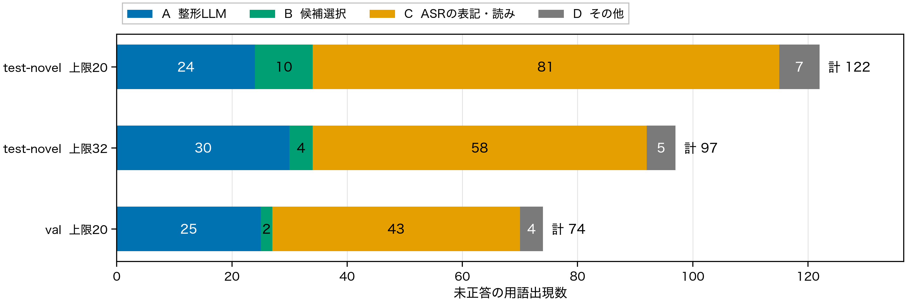

# FULL-scratchの用語誤りを段ごとに数える

## 結論

test-novelの上限20では、候補選択を見直す余地が最大46件ある。うち35件は、元の仮名や正表記に十分な証拠がなくても、現行選択器で上限64までに入った。上限32では選択側の余地が18件に減り、整形LLMにすでに候補が渡っていた誤りが30件残る。valの選択側の余地は7件で、整形LLMの25件と今回の候補変更で届かなかった43件中38件の方が多い。

| 条件 | 保存済み正答 | 未正答 | 選択側の候補追加余地の上限 | 今回の候補変更後もASR側に残る | 整形LLMに候補あり（うち採否後に正表記あり） | その他 |
| --- | ---: | ---: | ---: | ---: | ---: | ---: |
| test-novel 上限20 | 378/500 | 122 | 46 | 45 | 24（5） | 7 |
| test-novel 上限32 | 403/500 | 97 | 18 | 44 | 30（5） | 5 |
| val 上限20 | 1353/1427 | 74 | 7 | 38 | 25（13） | 4 |

選択側の上限は、元のASRに表記・読みの証拠があったB全件と、候補変更で一覧に入ったCの和集合の件数を足した値。Cの和集合には、上限48・64または下限70・65・60での候補追加と、漢字の読み照合で発話位置まで確認した追加を含む。Bも含めて今回の変更で実際に候補を追加できた和集合は、表の順に43、15、6件。独立した変更の和集合であり、一つの設定で得られる追加件数や整形後の正答数は未測定。ASR側の件数はCからこの和集合のC分を引いた値で、試した範囲で判断した残りである。



合成音声の保存済みFULL-scratch 1 runを条件別に再集計。1本の棒が1条件の未正答数。

## 誤りの内訳

| 分類 | test-novel 20 | test-novel 32 | val 20 |
| --- | ---: | ---: | ---: |
| A 一覧あり、採否後にも正表記あり | 5 | 5 | 13 |
| A 一覧あり、採否後に正表記なし | 19 | 25 | 12 |
| B 一覧外、順位が上限外 | 7 | 1 | 0 |
| B 一覧外、索引には載ったが下限未満 | 1 | 1 | 0 |
| B 一覧外、検索索引から採点候補に入らず | 2 | 2 | 2 |
| C 一覧外、元のASRに表記・近い仮名読みなし | 81 | 58 | 43 |
| D 整形後に表記の揺れあり | 7 | 5 | 4 |
| 合計 | 122 | 97 | 74 |

Dはいずれも大小文字・語内空白・文字幅を揃えると一致した。公式の正答数は厳密表記のまま集計した。B/Cに採否後の正表記が残っていた例は0件。Dのうち採否後に正表記があったのは表順に2、1、0件。

| Cの対応区間に残った形 | test-novel 20 | test-novel 32 | val 20 |
| --- | ---: | ---: | ---: |
| 漢字を含む別の表記 | 9 | 9 | 10 |
| ひらがな・カタカナの別の読み | 11 | 8 | 19 |
| 別の英数字表記（仮名との混在を含む） | 37 | 24 | 8 |
| 漢字と英数字の混在 | 8 | 5 | 1 |
| 語の一部が残る | 15 | 12 | 2 |
| 語の途中の音が抜ける | 1 | 0 | 3 |
| 対応区間の消失・判定不明 | 0 | 0 | 0 |
| 合計 | 81 | 58 | 43 |

例は、漢字が `k-means → 警民団`（`novel-000014`）、英数字が `VP9 → vp5`（`novel-000039`）、仮名が `timm → ティン`（`synth-val-000129`）、音抜けが `Edge → エジ`（`synth-val-001823`）。区間の型は台本とASRの文字対応から機械推定した。音声を使った型の確認は未実施。

## 上限と選択スコア

BとCの列は、各基準条件の**最終未正答のうち**新たに一覧へ入った出現数。「正解 ±」には最終正答だった語も含め、一覧に新たに入った数と押し出された数を示す。「発話外」は台本に根拠のない候補の数で、発話と候補語の組を単位とする。新規数に加え、入れ替わりで消えた数を差し引いた純増を載せた。

| 基準 | 変更 | B追加 | C追加 | 正解 ± | 発話外の新規 | 発話外の純増 |
| --- | --- | ---: | ---: | ---: | ---: | ---: |
| val 20 | 上限48 | 0 | 1 | +3 / −0 | 18,963 | 18,963 |
| val 20 | 上限64 | 0 | 1 | +3 / −0 | 26,389 | 26,389 |
| val 20 | 下限70 | 0 | 1 | +12 / −0 | 1,406 | 319 |
| val 20 | 下限65 | 0 | 3 | +20 / −0 | 3,855 | 824 |
| val 20 | 下限60 | 0 | 3 | +27 / −0 | 4,986 | 944 |
| test-novel 20 | 上限48 | 7 | 33 | +60 / −0 | 10,930 | 10,930 |
| test-novel 20 | 上限64 | 7 | 35 | +63 / −0 | 15,215 | 15,215 |
| test-novel 20 | 下限70 | 0 | 0 | +0 / −6 | 911 | 92 |
| test-novel 20 | 下限65 | 0 | 0 | +0 / −26 | 2,458 | 218 |
| test-novel 20 | 下限60 | 0 | 1 | +1 / −34 | 3,115 | 261 |
| test-novel 32 | 上限48 | 1 | 11 | +15 / −0 | 5,740 | 5,740 |
| test-novel 32 | 上限64 | 1 | 13 | +18 / −0 | 10,025 | 10,025 |
| test-novel 32 | 下限70 | 0 | 0 | +1 / −7 | 1,363 | 358 |
| test-novel 32 | 下限65 | 0 | 0 | +0 / −20 | 4,020 | 765 |
| test-novel 32 | 下限60 | 0 | 1 | +1 / −30 | 5,663 | 844 |

上限は下限75のまま変更し、下限を変える比較では一覧上限を固定した。下限だけの変更でBは増えなかった。下限未満のBはtest-novelの `Stacked Hourglass Network`（採点時の下限を0にした診断スコア66.67、上限20・32で同一の例）。下限65でも既存順位の上位32に入らない。

valを見て、正解候補を12件追加し、発話外候補の純増が調べた下限の中で最も小さい70を主比較に固定した。65と60も同じ値でtest-novelに適用して感度を数えた。test-novelの下限70は正解候補が上限20で6件、上限32で差し引き6件減った。順位が優先リストとスコア順の交互取りなので、下限を下げると上位枠の顔ぶれも変わる。

保存済みの**整形後**の実測では、test-novelの上限20→48が378→412（37件改善、3件悪化）、32→48は403→412（11件改善、2件悪化）。valの20→48は1353→1349（2件改善、6件悪化）。上限64と下限変更での整形後精度は未測定。test-novelでは枠を広げると候補が届く一方、発話外候補も大量に増える。次に選択を調べるなら、候補数を維持したまま、すでに採点できている語の順位を上げる変更を優先できる。

## 漢字をカナに直した場合

HaasとQwenをそれぞれ語に分け、漢字を含むトークンをカナにした。変換を含む連続トークンの読みを用語集と照合し、元の候補一覧へ加えた。読み照合の増加件数は上限適用前の値。台本で指定した発話位置にマッチ区間の半分以上が重なるとき、Cの読みが残った証拠として数えた。valでは1編集を許しても位置確認済みのCが増えず、発話外候補が75件増えたため、完全一致を主比較に固定した。

| 基準 | カナ照合 | C追加（うち位置確認済み） | 全正解語の候補追加 | 発話外の候補追加 |
| --- | --- | ---: | ---: | ---: |
| val 20 | 完全一致 | 1（1） | 9 | 240 |
| val 20 | 1編集まで | 1（1） | 10 | 315 |
| test-novel 20 | 完全一致 | 0（0） | 1 | 209 |
| test-novel 20 | 1編集まで | 0（0） | 3 | 264 |
| test-novel 32 | 完全一致 | 0（0） | 1 | 209 |
| test-novel 32 | 1編集まで | 0（0） | 3 | 262 |

valで拾ったCは `Annoy`（`synth-val-001795`、対応区間「あの意」）。同じ完全一致でBの `None` も1件増えた。全正解語の候補追加には、元の一覧になくても整形で正解していた語を含む。変換器が専門用語の漢字を誤読することや、トークン境界をまたいだ読みの揺れがあるため、試した方法で未回収だったCにも別の読み照合の余地は残る。

## 条件と判定規則

元の仮説は、同音に近い漢字表記や順位の押し出しが残るなら、ASRを更新せずに正解候補を増やせるというもの。既定のFULL-scratch、Haas＋Qwen3-ASR 0.6B、Whisperなしの保存出力を使った。valは1,000発話・1,427用語出現、test-novelは500発話・500出現。出現単位は既存評価の `terms`。正答は `min(正解出現数, hyp.count(用語))`。この保存出力はTransformers BF16で、手元のエンジンが整形の後に行う用語表記の復元は未適用。モデル再実行、追加学習、seedの変更や除外は行っていない。

- **A〜Dの順序**。参照文に要求された表記がない場合や出力の表記揺れはD。残りは実際に整形へ渡した一覧に語があればA。採否後の表記は厳密一致で分けた。一覧外では、記号と境界を保ちながら幅・大小文字・英字間の空白を揃えた表記か、元のASRにある近い仮名があればB。用語集や台本の用語マークが足りず判定できない場合はD。残りはC。
- **Bの仮名照合**。NFKC・カタカナに揃え、長音符・空白などを除いた。3文字以下はトークンまたは連続仮名区間全体の完全一致。4文字以上は連続仮名区間の部分窓に対し、文字Levenshtein距離が `min(2, 読み長 // 4)` 以下。ASRの文字を見て選ぶ判定なので、ローマ字スコアで拾えるCが存在する。Bの順位は下限75で枠を切る前の順位。下限未満と、索引の字句条件により未採点だった語を区別した。
- **Cの区間**。読み上げ台本の用語マークには合成時の指定読みを使い、周辺文と両ASRの漢字をカナにして編集距離で全文を対応させた。用語の周囲に対応する区間のうち、指定読みに近い方のASRを採った。同点はHaas。区間が空なら消失、途中の削除だけなら音抜け、短くなり連続一致が半分以上あれば部分残存、残りは元表記の文字種で分類した。公式採点は出現位置を記録しないため、同語が繰り返された場合は正答を先頭から割り当て、台本は末尾から必要数の用語マークを使った。
- **読み照合と発話外候補**。読み索引には既存の用語集の読みだけを入れた。1編集の照合は登録読みが5文字以上のときに限る。発話外候補は、正解 `terms`、台本の明示マーク、台本中の同じ表記のいずれにも根拠がない語。発音の同じ別の用語は発話外に含める。実音声の人手ラベルは使用していない。読み付与はmacOS 27.3（26C5035r）のCore Foundationで日本語のラテン文字転写を取り、Foundationでカタカナにした。英字は元表記を保持した。[Appleのトークナイザ仕様](https://developer.apple.com/documentation/corefoundation/cfstringtokenizer)
- **固定順序**。valで下限75/70/65/60とカナ完全一致/1編集を比較し、下限70・完全一致を主比較にして設定ファイルへ保存した。test-novelにはvalと同じ比較値を適用し、分類規則・しきい値の選択に用いていない。

## 入力と再現

facultyの `~/voiceime-work-wops/fix1/capacity-eval.sh` と、同 `runs/capacity/FULL-scratch/{inference,audit.json}` を使用した。選択器はmainの `c2ad2769819bcdb3fe1cf90fb760279692206889`。実験に使った版は `~/voiceime-work-fr3/overlays/glossary-main-c2ad276.py`（SHA-256 `e9db1b5d7ba52703300b4cb29099f2cb8da791361f6f895e931eac5f75eeedfa`）。選択入力・用語集・test-novel除外語は `~/voiceime-work-fr3/inputs/glossary-capacity-20261123-corrected/selection-audit.json` のパスとハッシュで照合した。候補プールはval 31,415語、test-novel 31,332語。入力と結果のハッシュは各splitの集計JSONにある。

一覧を作ったQwen出力と整形が受け取ったQwen出力はvalの146発話で異なる。B/Cと候補の反実仮想には、一覧を作ったASR出力を使った。valのB/Cを整形が受け取ったASR出力でも調べたところ、分類が変わる誤りは0件。test-novelでは2つのASR入力が500件すべて一致した。両splitの上限20・32・48の全一覧を順序まで再現し、公式監査の正答数、包含数、一覧内外それぞれの正答数と照合した。

手元のMacで、次のfaculty上のファイルをホームからの相対パスを保って一時ディレクトリへ展開する。

- `voiceime-work-fr3/inputs/glossary-capacity-20261123-corrected/` の `selection-audit.json` と `glossaries/{val,test-novel}/max{20,32,48}-haas-qwen.jsonl`
- 選択監査が参照する各splitの `manifest`、`first_pass`、`qwen`、`glossary_1`、`glossary_2`、`exclusions` と `selector_path`
- `voiceime-work-wops/runs/capacity/FULL-scratch/` の `audit.json` と `inference/{val,test-novel}-max{20,32,48}-haas-qwen.jsonl`

手元のMacのworktreeで、展開先を `ATTRIB_INPUTS`、RapidFuzz 3.14.6を使えるPython 3.12を `ATTRIB_PYTHON`、Matplotlib 3.11.1を使えるPythonを `ATTRIB_PLOT_PYTHON` として実行する。

```sh
swiftc -module-cache-path "$ATTRIB_INPUTS/swift-cache" \
  runs/error-attribution/tokenize_ja.swift -o "$ATTRIB_INPUTS/tokenize_ja"
for split in val test-novel; do
  "$ATTRIB_PYTHON" -B runs/error-attribution/attribute.py \
    --inputs "$ATTRIB_INPUTS" --tokenizer "$ATTRIB_INPUTS/tokenize_ja" \
    --split "$split" --settings runs/error-attribution/settings.json --out runs/error-attribution
done
MPLCONFIGDIR="$ATTRIB_INPUTS/mpl" "$ATTRIB_PLOT_PYTHON" -B -W error::UserWarning \
  runs/error-attribution/plot.py
```

集計と図は手元のCPUで実行した。用語別TSVから分類と追加件数を再集計し、集計JSONと一致することを確認した。図は表示して文字や注記が重ならないことを確認した。facultyの読み出しは `nice` を付けて実行し、終了時の関連プロセスは0件。合成音声の評価テキスト・用語集・監査と選択器の転送は圧縮後に計3,801,484バイト。本人の録音、重み、プロジェクトの依存は使用・変更対象から外した。読み付与用パッケージのインストールは承認設定により実行されず、macOS標準の機能に切り替えた。

[集計と図の生成コード](../../runs/error-attribution/) · [val集計](../../runs/error-attribution/val.json) · [test-novel集計](../../runs/error-attribution/test-novel.json) · [val用語別判定](../../runs/error-attribution/val-misses.tsv) · [test-novel用語別判定](../../runs/error-attribution/test-novel-misses.tsv)。用語別判定には出現ID、分類、候補への追加条件とCの短い対応区間だけを残した。`added_by` は候補に入れば1、Cのカナ照合で発話位置も確認できれば2。
