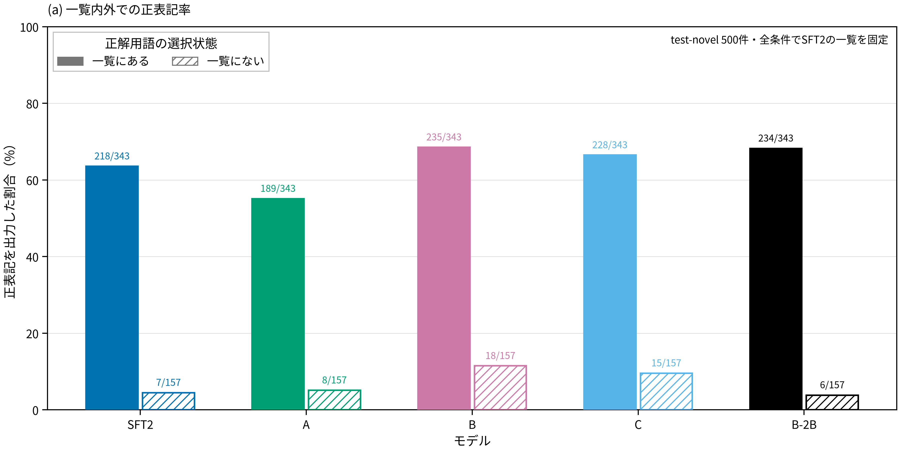

# SFT2と同じ用語一覧での再評価（2026-11-22）

## 条件

SFT2の保存済み用語一覧をIDごとに固定し、A/B/C/B-2Bを再評価した。Aは2回目だけ、BとB-2Bは1回目＋2回目、Cは1回目＋区間ごとの採否後の文を入力した。test-novelではSFT2と全条件の500行で、選択用語の表記と順序が完全一致した。正解語が一覧に入った件数も全条件343/500で一致した。候補はv1＋v2から`glossary-v2-excluded.txt`の83語を除いた31,332語、上限20語。

SFT2とAの一覧が本人50件とval1,000件でも一致することは、mainの`select_glossary`を用いたCPU照合で確認済み。B/C/B-2Bの一覧はこの比較のためSFT2の保存済み配列で固定し、入力文の違いが選択一覧へ与える影響を除いた。動的に一覧を選ぶ評価は別の診断値として、`main-glossary-dynamic-reeval-20261122.md`に残している。

SFT2基準は手元MLX 4bitの保存出力、A/B/C/B-2BはTransformers 5.23.0、PyTorch 2.13.0+cu129、H100、BF16、greedy、batch 32である。出力に`apply_output_style`を適用し、CERはmainの`voiceime.eval`定義で集計した。本人の読み上げに由来する入力と推論出力はfaculty内に置き、手元には集計表だけを移した。

SFT3推論は現在の`prompt.py`（複数ASR文の比較を含むsystem指示）で行った。保存済みSFT2出力は旧system指示で生成された値のため、SFT2との差はモデル/runtimeだけの差ではなく、指示文の変更も含む。

## 評価結果

| 系統 | 本人50件、全用語：CER / 正答 | 本人50件、見えない用語除外：CER / 正答 | val 1,000件：CER / 正答 | test-novel 500件：CER / 正答 |
| --- | --- | --- | --- | --- |
| SFT2（MLX 4bit） | 4.39% / 60/67 | 比較出力なし | 3.72% / 1301/1427 | 10.83% / 225/500 |
| A: 2回目だけ | 5.55% / 59/67 | 5.98% / 56/67（見えない14/20、他42/47） | 3.68% / 1309/1427 | 10.40% / 197/500 |
| B: 1回目＋2回目 | 5.89% / 58/67 | 5.38% / 58/67（見えない16/20、他42/47） | 3.31% / 1307/1427 | 8.26% / 253/500 |
| C: 1回目＋採否後の文 | 5.98% / 59/67 | 7.27% / 55/67（見えない13/20、他42/47） | 3.40% / 1315/1427 | 8.37% / 243/500 |
| B-2B: B入力、2B | 4.52% / 61/67 | 4.43% / 61/67（見えない18/20、他43/47） | 3.12% / 1328/1427 | 9.15% / 240/500 |

本人用語集はv1を使った。見えない用語を除く評価ではSFT2の保存出力が無いため、SFT2の値は示していない。test-novelのモデル別入力と選択用語は`inputs/test-novel-main-glossary-frozen-inputs.jsonl`、条件照合と失敗分類は`main-glossary-frozen-reeval-retry1-20261122/test-novel-audit-summary.json`にある。入力JSONLには各IDの1回目・2回目・結合文、選択用語、モデルへ渡すsystem/userメッセージを保存し、正解ラベルと推論出力は含めていない。

### test-novelでの一覧内外の成績

| 系統 | 正解語が一覧内 | 一覧内の正答率 | 正解語が一覧外 | 一覧外の正答率 | 合計正答 |
| --- | ---: | ---: | ---: | ---: | ---: |
| SFT2 | 218/343 | 63.6% | 7/157 | 4.5% | 225/500 |
| A | 189/343 | 55.1% | 8/157 | 5.1% | 197/500 |
| B | 235/343 | 68.5% | 18/157 | 11.5% | 253/500 |
| C | 228/343 | 66.5% | 15/157 | 9.6% | 243/500 |
| B-2B | 234/343 | 68.2% | 6/157 | 3.8% | 240/500 |

正解語が一覧内なのに表記を出せなかった例を文字列照合で分類した。読みが残る例を先に数え、それ以外は正解文と出力の`SequenceMatcher`対応範囲で置換文字があれば「別出力」、無ければ「脱落」とした。この対応付けは出力上の文字列による推定で、語義上の置換判定ではない。

| 系統 | 読みのまま | 別出力 | 脱落 | 一覧内で不正解の合計 |
| --- | ---: | ---: | ---: | ---: |
| SFT2 | 0 | 88 | 37 | 125 |
| A | 0 | 120 | 34 | 154 |
| B | 1 | 81 | 26 | 108 |
| C | 7 | 79 | 29 | 115 |
| B-2B | 0 | 86 | 23 | 109 |

BはSFT2より一覧内の正表記率が5.0ポイント高く、test-novel全体でも28語多く正解した。一覧内の語を採らない例はSFT2の125件からBの108件へ減った。Cでは読みのまま残る例が7件あり、A/B-2Bより多い。B-2Bは一覧内の正答率がBと近い一方、一覧外では6/157件にとどまった。

### 入力長と整形時間

以下の整形時間はbatch生成wall timeを件数で割ったthroughput換算値で、単発遅延ではない。

| 評価 | 条件 | 平均入力token | 平均prompt token | 平均整形時間（秒/件） |
| --- | --- | ---: | ---: | ---: |
| val 1,000件 | A | 31.76 | 431.72 | 0.0493 |
|  | B | 65.20 | 481.17 | 0.0504 |
|  | C | 65.20 | 488.17 | 0.0503 |
|  | B-2B | 65.20 | 481.17 | 0.0520 |
| test-novel 500件 | A | 34.78 | 471.04 | 0.0609 |
|  | B | 71.33 | 523.59 | 0.0632 |
|  | C | 71.33 | 530.59 | 0.0615 |
|  | B-2B | 71.33 | 523.59 | 0.0718 |

B/Cでは最初の認識を加えたため、平均入力tokenがAの約2.05倍、prompt tokenは約11%増えた。batch推論の平均整形時間の増加はvalで0.001秒/件前後、test-novelで0.001〜0.011秒/件だった。単発遅延ではなく、MLX 4bitとの速度比較には使えない。

## SFT2の本人CER差

SFT2の保存済み出力とAの入力文・用語配列は、本人評価50/50で一致した。現行manifestの50件では102/2,325文字、CER4.39%、用語60/67だったため、PM手元の3.82%は用語一覧の違いでは説明できなかった。SFT2の`e2e-devuser.jsonl`には100行あり、今回のmanifestに対して50行が未知IDとして報告された。3.82%のmanifest・対象行・正規化条件が確認できておらず、差の原因は未解決である。

## 学習ジョブ

この報告時点で、main選択を学習へ使う3つの0.8B変種をfaculty queueで実行中または待機中。条件はdrop 0/distractors 0、drop 0.15/distractors 0、drop 0/distractors 8。前2条件はcuDNN SDPAを無効にした同一設定で実行中で、stepはそれぞれ1,328/5,996と1,142/5,996。drop 0/distractors 8の旧backend実行は2,814/5,996、新backendの再実行はpending。旧backend出力は公平な最終ablationには使わない。学習結果、使用率、終了状態は完了後に追記する。

## 出典

- 集計表: `main-glossary-frozen-reeval-retry1-20261122/{devuser-all,devuser-no-unseen,val,test-novel}.report.txt`
- 合成評価の出力: `main-glossary-frozen-reeval-retry1-20261122/{A,B,C,B-2B}/{current,test-novel}/`
- test-novel入力照合: `inputs/test-novel-main-glossary-frozen-inputs.jsonl`と同run内の`test-novel-audit-summary.json`
- 図と生成コード: `figures/formatter-sft3/test-novel-glossary-selection-accuracy.png`、`figures/.work/formatter-sft3/test-novel-list-accuracy/plot.py`
- 本人読み上げ50件の推論JSONLはfacultyの`runs/formatter-sft3/main-glossary-frozen-reeval-retry1-20261122/`に保存し、手元へは移していない。
